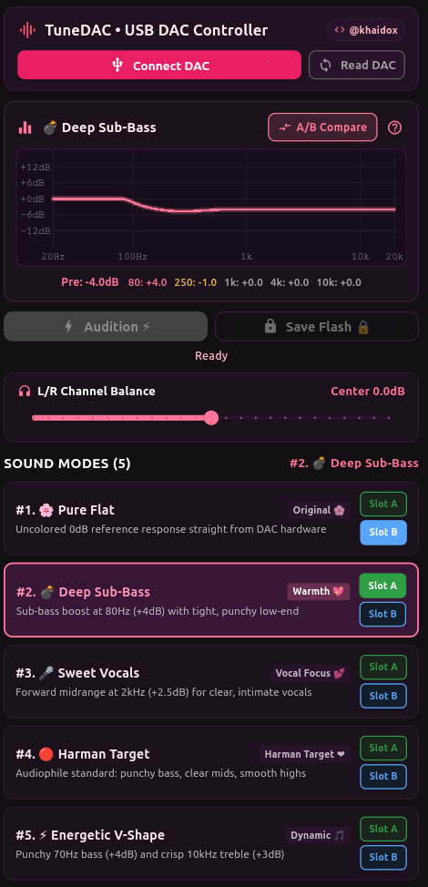

# 🎧 TuneDAC

**Hardware Parametric Equalizer Manager for KT Micro KT02H20 USB DACs**  
*(FiiO JadeAudio JA11 and compatible dongles)*

<p align="center">
  
</p>

---

## 📥 Downloads

Download the latest version directly from the [**Releases Page**](https://github.com/khaidox/TuneDAC/releases/latest):

| Platform | Download File | Requirements | Description |
| :--- | :--- | :--- | :--- |
| 📱 **Android** | [`TuneDAC-Release.apk`](https://github.com/khaidox/TuneDAC/releases/latest) | Android 8.0+ (USB-OTG) | Standalone APK, no Google Play Services or Root required. |
| 🐧 **Linux** | [`TuneDAC-Linux-x64.tar.gz`](https://github.com/khaidox/TuneDAC/releases/latest) | 64-bit Linux (GTK 3, ALSA/PipeWire) | Extract and run `./tunedac`. |
| 💻 **Windows** | `TuneDAC-Windows.zip` *(TODO)* | — | Standalone executable (`TuneDAC.exe`) — Planned for upcoming build. |

---

## ✨ Features

- **Direct Hardware DSP Control**: Communicates directly with the onboard KT02H20 DSP via USB HID protocols — no Root or Accessibility permissions needed.
- **5 Curated Audiophile Sound Profiles**:
  1. 🌸 **Pure Flat**: 0dB reference response straight from DAC hardware.
  2. 💣 **Deep Sub-Bass**: Punchy sub-bass boost at 80Hz (+4dB) with tight transient attack.
  3. 🎤 **Sweet Vocals**: Intimate forward midrange at 2kHz (+2.5dB) for crystal-clear vocals.
  4. 🔴 **Harman Target**: Internationally acclaimed target curve with deep sub-bass and clear treble.
  5. ⚡ **Energetic V-Shape**: Fun and dynamic profile with punchy bass and sparkling highs.
- **Instant A/B Comparison**: 1-Tap toggling between **Slot A** (Active Tuning) and **Slot B** (Reference Flat 0dB) while listening to effortlessly evaluate sonic differences in real time.
- **Real-Time Frequency Response Curve**: Interactive logarithmic graph (20Hz–20kHz) showing both active response and comparative dashed curves.
- **Multi-Layer Soft Micro-Mute**: Eliminates 100% of loud "pop" or "click" sound artifacts during IIR biquad filter parameter updates.
- **L/R Channel Balance**: Smooth stereo balance adjustment (-12dB to +12dB) with zero audio degradation.

---

## 🔌 Compatible Devices

TuneDAC supports USB DAC dongles equipped with the **KT Micro KT02H20** DSP chipset:

- **FiiO JadeAudio JA11** (VID: `0x2972`)
- Other compatible KT02H20-based USB Type-C Audio adapters

---

## 📱 Android Setup & Permissions

1. Download and install `TuneDAC-Release.apk`.
2. Connect your USB DAC dongle via Type-C.
3. When prompted: *"Allow TuneDAC to access USB device?"*, tap **OK**.

---

## 🐧 Linux Quick Start

```bash
tar -xzf TuneDAC-Linux-x64.tar.gz
cd TuneDAC
./tunedac
```

---

## 🛡️ Privacy & Security

- **100% Offline**: Zero network requests, zero telemetry, zero analytics.
- **No Background Drain**: The app only interacts with the DAC when active on screen.
- **Safe Hardware Operation**: Flash write operations are locked in this edition to prevent Flash ROM wear-out.

---

## 👨‍💻 Author & Developer

**TuneDAC** is developed and maintained by **[khaidox (Khai Do)](https://github.com/khaidox)**.

- 🌐 GitHub Profile: [@khaidox](https://github.com/khaidox)
- 📦 Repository: [https://github.com/khaidox/TuneDAC](https://github.com/khaidox/TuneDAC)
- 🎧 Hardware: KT Micro KT02H20 USB Audio DSP
- 💬 Feedback & Issues: [TuneDAC Issues](https://github.com/khaidox/TuneDAC/issues)
